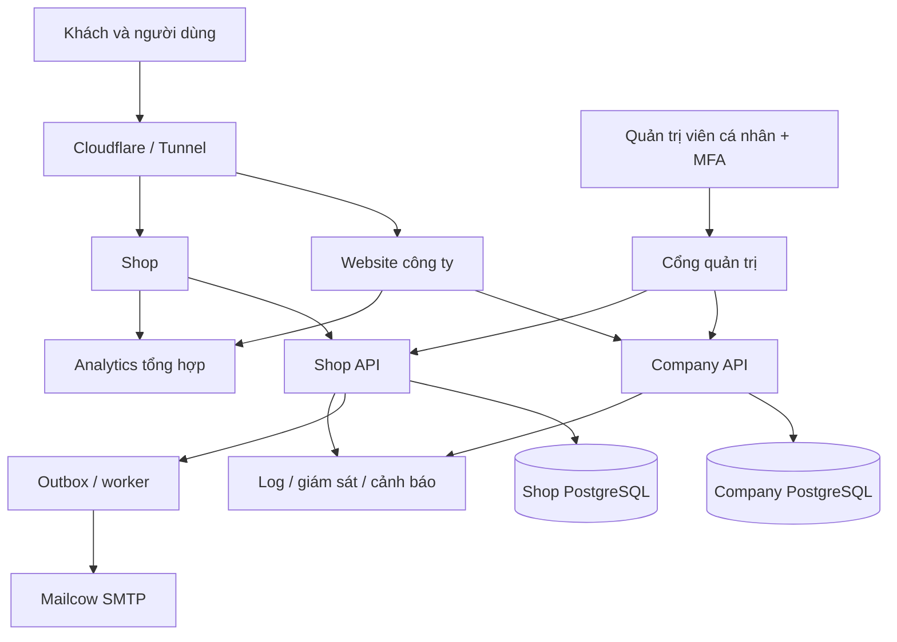

# Rà soát kiến trúc quản trị và theo dõi truy cập – Phúc Thành Holding

Ngày: 11/10/2026 (Asia/Saigon).
Phạm vi: mã nguồn D:\phucthanhholding, website phucthanhholding.com và shop.phucthanhholding.com. Không bao gồm dự án khác.

## Kết luận

Kiến trúc Node + PostgreSQL + Nginx + Cloudflare Tunnel có thể tiếp tục phát triển theo mô hình ứng dụng đơn khối có các module rõ ràng. Chưa cần microservices hoặc Kubernetes. Cần hoàn thiện quản trị danh tính, quyền truy cập, nhật ký, thống kê nghiệp vụ và vận hành trước khi tăng lượng người dùng hoặc chạy email marketing.

Đây là rà soát mã nguồn và hồ sơ triển khai trong cuộc trao đổi, không phải kiểm toán trực tiếp toàn bộ Ubuntu. Chưa xác minh cấu hình Cloudflare Analytics, firewall, backup định kỳ, IP thực nhận, tài khoản thực tế hoặc tải production. Gói shop-registration-notifications-20261011 đã tạo và kiểm thử nhưng chưa có xác nhận triển khai.

## Hiện trạng có bằng chứng

| Hạng mục | Website công ty | Shop |
|---|---|---|
| Danh tính | admin_users/admin_sessions; cookie HttpOnly/Secure, phiên 8 giờ | Người dùng email xác minh hoặc Google, cookie phiên; tài khoản và dữ liệu riêng theo user_id |
| Quản trị | Quản lý nội dung và yêu cầu liên hệ; các admin dùng chung phạm vi quyền hiện tại | Gói mới có danh sách người dùng, CSV nhận tin; isAdmin so khớp hai email cố định |
| Nhật ký | admin_audit_log ghi thay đổi nội dung trong giao dịch | Chưa có nhật ký đầy đủ cho đăng nhập, truy cập dữ liệu, xuất CSV hoặc cấp quyền |
| Dữ liệu tiếp thị | Form liên hệ lưu consent phục vụ yêu cầu liên hệ; không suy ra consent quảng cáo | Gói mới có marketing_consent, thời điểm, nguồn, nội dung; chưa có lịch sử bất biến |
| Thông báo | Không xác nhận có thông báo người dùng/CRM đầy đủ | Gói mới quét mỗi 60 giây, tối đa 20 tài khoản; trạng thái chờ gửi được lưu DB |
| Truy cập | Không tìm thấy tích hợp pageview/event chuyên dụng trong mã | Tương tự; lịch sử do người dùng lưu không phải nhật ký sử dụng tất cả công cụ |
| Vận hành | Healthcheck, quyền PostgreSQL tối thiểu, Docker log rotation | Health endpoint; API Compose chưa khai báo healthcheck; retention 90/30/180 ngày |

Các nguồn mã chính: server/schema.sql, server/app.mjs, shop/server/app.mjs, shop/server/schema.sql, shop/server/marketing.mjs, shop/server/cleanup.mjs, shop/nginx.conf, deployment/fresh-stack/nginx.conf và các Compose tương ứng.

## Những khoảng trống cần xử lý

1. Quyền quản trị shop gắn cứng với email info và phuclv. Nếu info là hộp thư chung, không phân biệt được người thao tác. Quyền nhận thông báo không nên đồng nghĩa quyền quản trị. Website công ty cũng chưa có mô hình vai trò theo nhiệm vụ.
2. Chưa có khóa/mở tài khoản có lý do, thu hồi toàn bộ phiên, đổi email có tái xác minh, khôi phục mật khẩu qua token một lần, MFA quản trị và lịch sử cấp/thu hồi quyền.
3. Nginx gán X-Real-IP từ remote_addr. Qua Tunnel/Docker, giá trị có thể là IP trung gian. Cần đo thực tế rồi xác định proxy được tin cậy; không lấy header khách gửi trực tiếp làm IP thật.
4. Audit website công ty chỉ bao phủ một phần ghi nội dung. Đăng nhập lỗi, bị từ chối quyền, xem/xuất danh sách và thay đổi consent chưa được ghi tập trung.
5. Consent mới chỉ lưu lựa chọn cuối cùng. Đổi lựa chọn có thể làm mất lịch sử chứng minh trước/sau. Cần consent_events chỉ thêm, có phiên bản nội dung và mục đích.
6. Notification dùng cờ trên users và worker trong API. Chưa có bộ đếm thử lại, thời điểm thử tiếp, dead-letter, khóa tác vụ khi nhiều worker hoặc theo dõi từng người nhận. Có thể gửi lặp khi SMTP nhận thư nhưng DB chưa ghi thành công. SMTP chấp nhận không đồng nghĩa vào Inbox.
7. Docker log rotation không thay thế phân tích truy cập, log tìm kiếm tập trung hoặc cảnh báo. Chưa có request_id xuyên Nginx/API/provider.
8. Chưa thấy theo dõi sự kiện công cụ tự động: thành công/thất bại, thời gian, quota, provider/model, lượng token và chi phí thực tế. Không thể suy ra chúng từ lịch sử do người dùng tự lưu.
9. Chưa thấy backup off-site định kỳ và kiểm thử restore. Máy chủ Ubuntu duy nhất vẫn là điểm lỗi chung cho web, shop, database và mail.
10. Chưa có kiểm soát tài nguyên CPU/RAM/PID đầy đủ trong Compose đang rà soát. Xử lý media và scrypt cần giới hạn đồng thời, hàng đợi và theo dõi dung lượng.

## Kiến trúc đề xuất

Giữ database website và shop tách biệt. Dùng một cổng quản trị nội bộ với API được phân quyền theo site, thay vì cho giao diện truy cập trực tiếp database. Phân tích truy cập dùng database/dịch vụ riêng; không trộn sự kiện web khối lượng lớn vào bảng giao dịch người dùng.

Cổng quản trị là đề xuất, chưa tồn tại. Ưu tiên một giao diện thống nhất; chưa gộp cơ sở dữ liệu tài khoản hoặc cookie xuyên tên miền. Nếu cần SSO sau này, dùng OIDC với nhà cung cấp danh tính thay vì tự chia sẻ cookie Domain rộng.

## Quyền và quản trị người dùng

| Vai trò | Quyền đề xuất |
|---|---|
| Owner | Cấp quyền, cấu hình hệ thống, phê duyệt tác vụ nhạy cảm |
| Admin | Quản lý tài khoản và phiên; không mặc định quản lý bí mật hạ tầng |
| Support | Xem thông tin tối thiểu, hỗ trợ xác minh, theo dõi ticket |
| Content Editor | Nội dung website; không truy cập danh sách email shop |
| Marketing | Danh sách đã đồng ý, suppression, chiến dịch; không truy cập mật khẩu hoặc token |
| Analyst | Báo cáo tổng hợp, không xuất danh sách email mặc định |
| User | Hồ sơ, phiên và dữ liệu của chính mình |

Mỗi nhân viên có danh tính riêng. info chỉ nhận thông báo nếu là mailbox chung. Cấp quyền theo permission + scope site, kiểm tra backend mỗi yêu cầu, mặc định từ chối. Thay đổi quyền, xuất dữ liệu và khóa tài khoản phải audit; thao tác nhạy cảm yêu cầu đăng nhập lại/MFA. Khóa tài khoản không xóa dữ liệu và thu hồi tất cả phiên trong cùng giao dịch.

Bảng đề xuất: roles, permissions, role_permissions, user_role_assignments (scope), auth_events, admin_audit_events. user thêm status và thời điểm đăng nhập gần nhất. audit ghi actor_id, site, action, target, outcome, request_id, thời điểm; chỉ lưu thay đổi trường an toàn, không sao chép token/mật khẩu vào before/after.

## Theo dõi truy cập đủ dùng

Phân biệt ba lớp:

- Traffic hạ tầng: request, bot, 4xx/5xx, băng thông, cache, thời gian phản hồi. Dùng Cloudflare/Nginx.
- Web analytics: trang, lượt truy cập ước tính, nguồn truy cập, UTM, thiết bị, chuyển đổi. Dùng một nền tảng chuyên dụng; cần theo dõi route React khi điều hướng SPA.
- Nghiệp vụ: đăng ký, xác minh, đăng nhập, công cụ, quota và lỗi provider. Các kết quả phải lấy từ backend đã hoàn tất giao dịch, không tin sự kiện frontend tự báo thành công.

Đề xuất event: page_view, signup_form_opened, registration_pending, email_verified, login_succeeded, login_failed, tool_started, tool_completed, tool_failed, contact_submitted, marketing_opt_in, marketing_opt_out. Thêm event_id để chống đếm trùng; cố định tên và kiểu trường. registration_pending không phải người dùng đã xác minh; thông báo quản trị không làm tăng số chuyển đổi.

Dashboard công ty: trang đích, nguồn khách, thiết bị, nội dung được xem, gửi liên hệ, lỗi form. Dashboard shop: phễu mở form → gửi đăng ký → xác minh → đăng nhập → công cụ đầu tiên, công cụ phổ biến, người hoạt động theo thời gian, tỷ lệ lỗi và thời gian xử lý. Chỉ so tỷ lệ khi mẫu số/cửa sổ thời gian rõ ràng; không coi số request là số người.

Khách ẩn danh không có danh tính email chỉ từ IP. Không gửi email hoặc tên người dùng trong URL/UTM. Không ghi nội dung form, prompt, file, mật khẩu, token xác minh, cookie hay Google code vào analytics. Dùng mã giả danh khi cần phân tích người dùng; tránh fingerprinting và chưa bật session replay/heatmaps ở bước đầu.

| Công cụ | Vai trò | Khuyến nghị |
|---|---|---|
| Cloudflare Analytics / Web Analytics | Traffic, bảo vệ và báo cáo truy cập cơ bản | Dùng bổ sung; không thay quản lý người dùng hoặc event nghiệp vụ |
| Umami tự host | Pageview, nguồn truy cập, sự kiện của hai website | Phương án khởi đầu gọn; cần vận hành/cập nhật/backup riêng |
| Matomo | Phân tích web chi tiết, yêu cầu triển khai và cấu hình cao hơn | Cân nhắc khi nhu cầu báo cáo tăng |
| Search Console | Hiển thị, click, truy vấn và index trên Google Search | Bổ sung cho SEO; không phải thống kê toàn bộ người truy cập |

Chọn một công cụ analytics chính để tránh đếm lặp và tăng tải. Ưu tiên Umami + event backend + Search Console. Dữ liệu dashboard vận hành có thể đọc từ PostgreSQL theo thống kê ngày; chưa cần đưa toàn bộ log vào stack giám sát nặng.

## Email marketing và consent

Marketing consent khác analytics consent và khác yêu cầu liên hệ. Lưu purpose, version/text, granted/revoked, occurred_at, user_id và source trong consent_events. Tài khoản cũ không tự chuyển opt-in.

Outbox transaction cùng lúc xác minh hoặc tạo Google user. Worker có attempts, next_attempt_at, trạng thái theo người nhận, khóa nhận việc và giới hạn gửi. Giữ SMTP event gửi/chấp nhận khác event delivered/bounced. Tăng độ tin cậy theo kiểu at-least-once, có chống trùng theo event khi phù hợp; không hứa SMTP exactly-once.

Trước khi mở chiến dịch: có suppression/unsubscribe hiệu lực ngay, loại email bounce, giới hạn tốc độ, nội dung theo mục đích đã đồng ý và quản lý danh sách mới nhất. Link hủy nhận tin riêng không yêu cầu mật khẩu; không dùng token xác minh tài khoản làm token hủy. Không dùng CSV cũ bỏ qua người đã hủy. Chưa triển khai tự động gửi quảng cáo trong gói hiện tại.

## Vận hành và dữ liệu

Ưu tiên request_id, JSON log đã che bí mật, API health/readiness, cảnh báo 5xx/quota/provider/SMTP, dung lượng ổ đĩa và PostgreSQL. Nhật ký đăng nhập và audit tách khỏi log truy cập. Healthcheck SMTP không chạy ở từng request.

Thời hạn đề xuất để duyệt: raw analytics 90 ngày, log truy cập 30 ngày, sự kiện bảo mật/audit 180 ngày; báo cáo tổng hợp 12 tháng. Đây là phương án, chưa áp dụng. Lịch sử 90 ngày, mốc YouTube 30 ngày và liên hệ shop 180 ngày là chính sách đã lựa chọn trước. Xác minh riêng cleanup website công ty.

Backup database hằng ngày, bản off-site được mã hóa, kiểm thử restore định kỳ; thêm migration version và pipeline build/test trước production. Chốt RPO/RTO với doanh nghiệp, không suy ra từ việc từng có backup thủ công. Khi phục hồi backup cũ, phải bảo toàn suppression/consent thu hồi mới và không vô tình đăng ký nhận tin lại.

## Thứ tự triển khai và nghiệm thu

| Giai đoạn | Công việc | Nghiệm thu |
|---|---|---|
| 1 | Đối chiếu Ubuntu/gói mới, IP thật, quyền quản trị cá nhân, MFA, thu hồi phiên, audit xuất dữ liệu | Hai người khác vai trò được kiểm tra deny/allow; IP đúng qua Tunnel và không tin header giả |
| 2 | Analytics hai site và event chuyển đổi backend; trang tổng quan | Route SPA đếm đúng; đăng ký/xác minh không trùng; không chứa email/token/form |
| 3 | Consent history, outbox, nhận thông báo, suppression/hủy nhận tin | Không đồng ý vẫn dùng công cụ; hủy loại ngay khỏi danh sách; SMTP lỗi không mất notification |
| 4 | Reset password, hỗ trợ tài khoản, log/cảnh báo, backup và restore | Token một lần/hết hạn; thu hồi phiên; restore thành công và không phục hồi consent đã hủy |

Không đưa email marketing, tổng số người dùng, lợi nhuận hoặc chi phí AI lên dashboard bằng số giả. Các module tương lai như thanh toán phải có nguồn dữ liệu và đối soát riêng khi được triển khai.

## Nguồn kỹ thuật đã đối chiếu

- OWASP Authorization: https://cheatsheetseries.owasp.org/cheatsheets/Authorization_Cheat_Sheet.html
- OWASP Logging: https://cheatsheetseries.owasp.org/cheatsheets/Logging_Cheat_Sheet.html
- OWASP Session Management: https://cheatsheetseries.owasp.org/cheatsheets/Session_Management_Cheat_Sheet.html
- Cloudflare IP headers: https://developers.cloudflare.com/fundamentals/reference/http-headers/
- Cloudflare Web Analytics FAQ: https://developers.cloudflare.com/web-analytics/faq/
- Umami: https://docs.umami.is/docs
- Matomo User ID privacy: https://matomo.org/faq/reports/user-id-privacy-considerations/
- Google Search Console: https://developers.google.com/search/docs/monitor-debug/search-console-start
